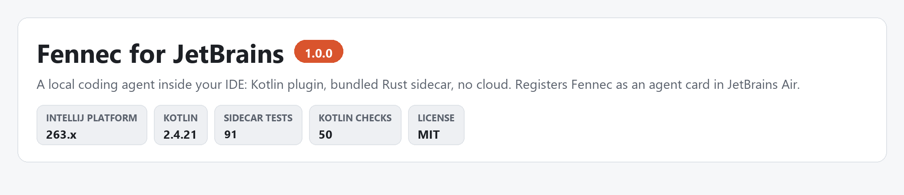

Registers **Fennec** as an agent card in JetBrains Air, installs the native ACP launcher
behind it, and adds Access/Model selectors directly to Air's New Session composer. Everything runs on this machine.

## At a glance

| Rust unit tests | Rust integration tests | Kotlin checks | Plugin zip | Sidecar binary |
|---|---|---|---|---|
| 75 | 16 | 50 | 488 KiB | 776 KiB |

Test counts measured on 2026-11-26: 75 unit and 16 integration in `sidecar/`, which together are the 91 the lane measures, and 50 headless checks in `src/test/kotlin/`. Sizes from a local build of the
working tree: `build/Fennec-plugin-1.0.0.zip` (499,357 B) and the packaged
`fennec-acp.exe` (794,624 B). This is the 1.0.0 release published on 2026-11-26.

## Architecture

```
JetBrains Air ── ACP v1 over stdio ──► fennec-acp (Rust supervisor)
                                          │ spawns, pumps stdio, propagates exit codes
                                          ▼
                                     acp.py (Python)
                                          │ engine starts on first prompt
                                          ▼
                                     local engine (default HTTP :8184)

Air New Session composer ── Fennec actions ──► fennec-acp --rpc
                                                   ├─ controls/get
                                                   └─ controls/set

Air ACP stdio ───────────────────────────────────► fennec-acp
                                                   └─ forwards ACP, applying the saved access mode
```

| Layer | Owns |
|---|---|
| Kotlin | Air registration, composer Access/Model/Reasoning controls and recommended-model download, Kotlin UI DSL settings panel; sidecar streaming bridged with coroutine `Flow` |
| Rust (`sidecar/`, self-contained crate) | the single `fennec-acp` binary: ACP launcher/supervisor and the `--rpc` control service (`controls/get`, `controls/set`) |
| fennec-core | ACP v1 itself (`acp.py` at the repo root); the sidecar owns no protocol code |

> [!NOTE]
> The sidecar is a **subprocess**, not a JNI/Panama library, and the protocol is JSON-RPC
> over stdio — not MCP. A crash in the native code or the agent cannot take down the IDE.
> The sidecar's only dependencies are `serde`, `serde_json` and `httparse`.

## What it does

| Behavior | Detail |
|---|---|
| Sidecar install | `~/.fennec/air/fennec-acp[.exe]`, registered as the launch command in `~/.jetbrains/acp-registry-installed-overlay.json` (the binary is the command; no arguments) |
| Registry merge | a `fennec` entry in a Fennec-owned copy of Air's registry at `~/.fennec/air/registry.json`; Air is pointed at it via `air.acp.registry.path` in the user `.vmoptions`. Air's cached registry is the base, so built-in agents stay visible |
| Installed card | marks Fennec in Air's shared `installed.json` — a real card with install/enable/disable controls; the catalog carries a supported platform binary schema, while the installed overlay replaces it with the bundled local sidecar |
| Legacy cleanup | removes the old `Colibri` entry from `~/.jetbrains/acp.json` only when it points at a managed launcher (sidecar or retired Python shim); other custom agents are never touched |
| Engine lifecycle | starts on the first prompt, stops after idle; an already-running engine is attached to and left alone |
| Access control | Composer selector: Ask every time forwards ACP permission requests to Air; Auto approve and Full access answer them in the sidecar with `allow_always` |
| Model selection | Composer selector lists only engine-ready local checkpoints from core's classifier; unconverted or unsupported models are not offered |
| Model download | “Download new model…” runs core's resumable recommended-checkpoint downloader with progress, then selects the completed model |
| Reasoning | The model menu carries Auto, Low, Medium, and High effort levels, saved in the shared config and used by the next agent run |
| Model update | writes `model` in the shared config atomically, preserves unrelated keys, validates readiness, and creates a backup |
| Update check | hourly against this repo's GitHub releases, once per version per IDE run. It only announces: a plugin is replaced by the IDE's own installer, never by itself |

The catalog entry includes Air's supported `distribution.binary.<platform>` shape so Air keeps
Fennec visible. The installed overlay then supplies `distribution.local` with the extracted
sidecar path, so launches stay local and do not use the catalog fallback archive. Registry changes
apply after the next IDE start (the override is a JVM option). On an OS with no bundled sidecar
binary, registration is skipped with a warning.

## Composer controls and settings

The **Fennec** buttons sit on Air's `Fennec [*]` line below the New Session prompt and use the
desktop composer's muted chips, mode-colored access label, and model arrow:

- **Access:** Ask every time, Auto approve, or Full access. The choice is saved under
  `~/.fennec/air/access.json`; Auto approve and Full access make the sidecar answer ACP
  permission requests without forwarding them to the IDE.
- **Model:** choose an engine-ready local checkpoint or Default. The list comes from
  `fennec-core/setup_wizard.py`'s classifier, so GGUF-only, unconverted, or otherwise
  unservable folders are not offered. **Download new model…** runs the same core downloader
  as the desktop setup wizard, keeps partial files for resume, and selects the finished model.
- **Reasoning:** Auto, Low, Medium, or High. The level is stored as `reasoning_effort` in
  `~/.fennec/config.json` and applies to the next agent run.

Access changes apply to new permission requests immediately. Reasoning changes apply to the next
agent run; model changes apply the next time the engine starts. Settings under **Tools → Fennec** retain the optional sidecar path
override, engine Python preview, update check, and channel selection.

## Browser / web-agent outlets (optional)

A fennec-core feature, not plugin code: the ACP agent can hand a solvable, URL-scoped browser
task to an outlet and read the result back. Optional, gated by the same per-turn
approvals as every other tool, never required for the core coding flow. `web_task` is Fennec's
own loop, which asks a Liquid **d1** model one question per step (the hosted `d1.2` with a
`LIQUID_API_KEY`, or the free open-weight `d1-2B` behind a `LIQUID_ENDPOINT` on loopback);
`coworker_task` is [OpenBot](https://github.com/CopilotKit/OpenBot), used exactly as upstream
and never modified.

`fennec-acp --check` forwards the flag to fennec-core's `acp.py`, which prints what the agent
advertises — including whether each outlet is present.

## Build

```bash
./build-plugin.sh    # outputs build/Fennec-plugin-1.0.0.zip
```

Builds the Rust sidecar offline, compiles Kotlin against the IDE platform with the local
`kotlinc` (no Gradle, `-jvm-target 21`), and packages every binary it finds under
`sidecar/<os-dir>/`. The IDE provides the Kotlin stdlib and coroutines; neither is bundled.

| Variable | Default | Meaning |
|---|---|---|
| `FENNEC_IDE_PLATFORM` | a detected local IntelliJ-platform 263.x install | any IntelliJ-based IDE install (263.x) to compile against |
| `FENNEC_KOTLINC` | `kotlinc` / `kotlinc.bat` on PATH | path to the Kotlin compiler |
| `FENNEC_SIDECAR_TARGET` | `rustc -vV` host triple | Rust target triple for the one bundled sidecar |

Install the zip via *Settings → Plugins → Install Plugin from Disk* and restart the IDE;
Fennec then appears on Air's Agents page.

### Platform support

> [!IMPORTANT]
> Only the **Windows x64** sidecar is built in this repository. The macOS and Linux binaries
> are **not built** here — cross-compiling them needs toolchains and linkers that are not
> present on this machine. No stub or placeholder binaries are shipped. On those platforms
> the plugin loads, but the Fennec composer actions report that no sidecar is bundled until
> a binary is built and packaged.

To produce them on a machine with the right toolchains:

```bash
rustup target add x86_64-apple-darwin aarch64-apple-darwin \
                  x86_64-unknown-linux-gnu aarch64-unknown-linux-gnu
FENNEC_SIDECAR_TARGET=x86_64-apple-darwin        ./build-plugin.sh   # macOS x64
FENNEC_SIDECAR_TARGET=aarch64-apple-darwin       ./build-plugin.sh   # macOS ARM
FENNEC_SIDECAR_TARGET=x86_64-unknown-linux-gnu   ./build-plugin.sh   # Linux x64
FENNEC_SIDECAR_TARGET=aarch64-unknown-linux-gnu  ./build-plugin.sh   # Linux ARM
```

## Configure

The sidecar reads the suite configuration (`~/.fennec/config.json` or `$FENNEC_CONFIG`, plus
`FENNEC_*` variables) shared with the desktop app, CLI and installer: engine root, Python,
model, engine URL, policy, backend and `ctx`. The plugin's access mode is the only separate
control file, `~/.fennec/air/access.json`, because ACP approval behavior belongs to the sidecar.

| Override | Effect |
|---|---|
| `FENNEC_CORE` | run fennec-core from a non-default checkout (the directory containing `acp.py`) |
| `FENNEC_SUITE` / `suite_root` | where to look for the `fennec-core` folder; a checkout next to this repo is also probed |
| `FENNEC_ACP_IDLE_TIMEOUT` | idle-engine stop timeout in seconds, read by fennec-core (default 300) |

## Tests

```bash
./run-tests.sh
```

| Suite | Count | Covers |
|---|---|---|
| Rust unit (`sidecar/`) | 75 | discovery, atomic model config updates, access modes, reasoning effort, permission replies, chunking, cosine index, embedding client, JSON-RPC dispatch |
| Rust integration (`sidecar/tests/cli.rs`) | 16 | the built binary over stdio: flag forwarding, crash/exit-code propagation, EOF shutdown, control RPC round trips, automatic permission answers, and chunk/search against a loopback fake embedding service |
| Kotlin headless | 50 | SharedConfig contract, control-state parsing, Air registration: registry merge, overlay, vmoptions, idempotency, legacy cleanup; the updater's version and release-payload decisions. Injected environments and temporary homes |

No engine, no model, no real network, no IDE — and no paid API. The ACP protocol itself is
tested in `fennec-core/tests`. The Kotlin UI compiles against the real platform but is not
exercised by these tests.

## Credits

Engine: [Liso7150/fennec](https://github.com/Liso7150/fennec). Base idea:
[JustVugg/colibri](https://github.com/JustVugg/colibri) — device-tiered MoE inference.
Fine-tuning: [AirLLM](https://github.com/lyogavin/airllm). Browser policy: Liquid
[d1](https://api.liquid.ai/decisions/v1/systemone) — the hosted `d1.2` or the open-weight
`d1-2B`. Coworker outlet: [OpenBot](https://github.com/CopilotKit/OpenBot). Part of the
[Fennec suite](https://github.com/Liso7150/fennec-environment-setup).